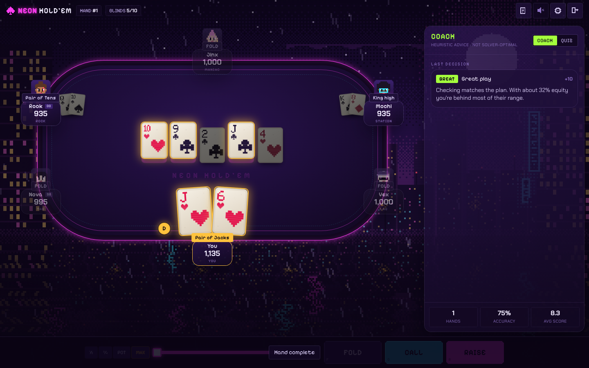
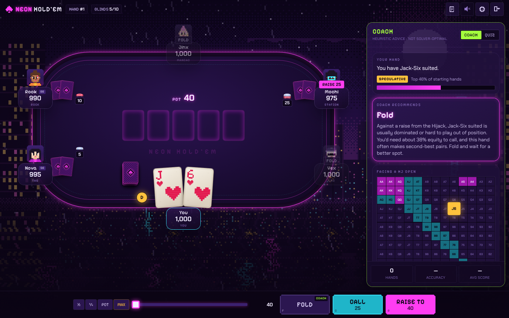
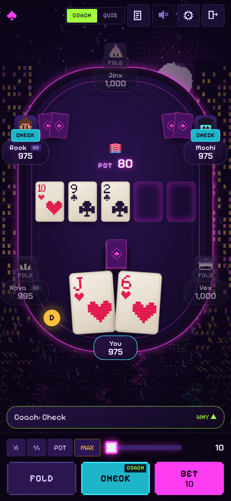

# Neon Hold'em

**Learn No-Limit Texas Hold'em at a rain-soaked neon table.** You play against five bots, each with its own personality, while a built-in coach explains your hand, the odds and the right play at every decision. It can also grade you after you act.



| Coach panel | Phone (390×844) |
|---|---|
|  |  |

## Features

- **Full No-Limit Hold'em for 2–6 players:** blinds, four betting streets, min-raise rules, short all-ins that don't reopen the betting, uncalled-bet refunds, multiple side pots, split pots and odd chips.
- **The coach**, shown on your turn:
  - Your hand in plain English ("You have a pair of Queens (top pair) with an Ace kicker"), with a strength tier and percentile.
  - **Preflop:** the standard chart for your spot (open / vs. raise / vs. 3-bet) on a 13×13 range grid, with your hand highlighted.
  - **Postflop:** Monte Carlo equity (8,000 run-outs in a Web Worker) against estimated opponent ranges, pot odds and the equity you need, an outs list with the rule of 2 & 4, and named draws (flush draw, OESD, gutshot…).
  - A recommended action and size, with a 2–3 sentence explanation of *why*.
  - **Coach mode** shows advice before you act. **Quiz mode** has you act first and then grades the decision: Great / Good / Mistake / Blunder.
  - An end-of-hand summary covers the result, the showdown, each decision's grade and a hand score.
  - Session stats (hands, accuracy, average score) are saved to localStorage.
  - Advice is clearly labelled **heuristic, not solver-optimal**.
- **Five bots:** Nova (TAG), Rook (rock), Jinx (maniac), Mochi (calling station) and Vex (LAG). They decide using hand strength, position, pot odds and some randomness, and "think" for 0.6–1.5 s.
- **Animations:** deck shuffle, a clockwise staggered deal from the dealer's position, a 3D flip of your cards, a staggered flop, chips that slide in and get collected, the pot flying to the winner, the winning five cards lifting and glowing, and folded hands sliding to the muck. `prefers-reduced-motion` is respected.
- **Synthesised chiptune sounds** via Web Audio, with no audio files and a mute toggle.
- **Extras:** a landing screen, How to Play (rules plus a hand-rankings chart), settings (bots, stack, blinds, speed, sound, mode), hand history with a step-by-step **replay**, and keyboard shortcuts.
- **All art is original and generated in code:** the pixel city with rain and reflections, pixel avatars, cards, chips and icons.

### Keyboard

| Key | Action |
|---|---|
| `F` | Fold |
| `C` | Check / Call |
| `R` | Bet / Raise (slider amount) |
| `Enter` | Deal next hand (from the summary) |
| `←` `→` `Space` | Step / play the replay |

## Run it

Requires Node 20+.

```bash
npm install
npm run dev          # http://localhost:5173
```

| Script | What it does |
|---|---|
| `npm run dev` | Vite dev server |
| `npm test` | Vitest: engine, coach, bots, store and UI tests |
| `npm run lint` | ESLint |
| `npm run build` | Type-check + production build into `dist/` |
| `npm run screenshot` | Starts the dev server, plays hands in Chromium at 1440×900 and 390×844, saves `screenshots/`, and fails on any console error |

`npx playwright install chromium` is needed once before `npm run screenshot`.
Add `?seed=123` to the URL for reproducible deals and bot decisions.

## Architecture

```
src/
  engine/   pure TS: cards, seeded RNG + shuffle, betting state machine, side pots, 7-card evaluator
  coach/    pure TS: preflop ranges, Monte Carlo equity (+ Web Worker), outs & draws,
            plain-English descriptions, advice, grading
  bots/     pure TS: five rule-based personalities
  store/    Zustand store: drives the game loop (engine → UI, one-way), coach, stats, replay
  ui/       React components (Table, Seat, Card, CardBack, ChipStack, Pot, ActionBar,
            CoachPanel, HandHistory, …), screens, procedural art
  ui/motion.ts   every animation duration, easing, spring and variant
```

- **The engine is immutable and step-wise.** `startHand → applyAction* → advanceStreet* → handComplete`. Each call returns a new `GameState`, which makes replays trivial (the store keeps a snapshot per step) and lets the UI pace street transitions for animation.
- **The evaluator** packs category plus kickers into one comparable integer, so it's fast enough for Monte Carlo. It's tested for the wheel, the steel wheel, board-plays splits, kicker ties, flush vs. straight, full-house ordering and multiple side pots.
- **Equity** runs in `coach/equity.worker.ts`. Opponent ranges come from preflop role (the opening range for the raiser's position, 3-bet, call or limp) and are narrowed to pairs and draws after postflop aggression.
- **Design tokens** (colours, fonts, radii, shadows) live only in the Tailwind `@theme` in `src/index.css`. Canvas and SVG art read the same CSS variables through `ui/palette.ts`.
- **Layout** is computed in pixels from the stage size (`ui/geometry.ts`), with separate landscape and portrait table shapes, so every card and chip flight animates between exact coordinates.

The coaching heuristics use the research and range data in `research/` and `data/` (the RFI ranges and the 169-hand equity table).

## Deploy (Vercel, free)

1. Push this repo to GitHub.
2. At [vercel.com/new](https://vercel.com/new), import the repo. Vercel detects **Vite** automatically (build `npm run build`, output `dist`).
3. Click **Deploy**.

Or from the terminal: `npm i -g vercel && vercel` (then `vercel --prod`).
